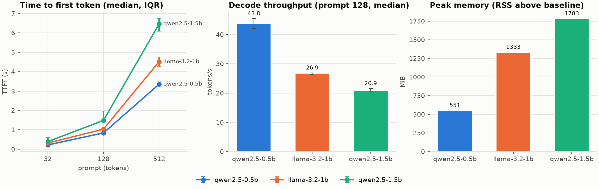
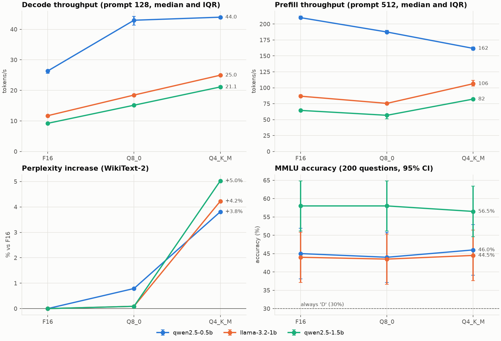

# llmbench — LLM inference benchmark

A reproducible benchmark of small open-source LLM inference: TTFT, latency, throughput,
memory, then the effect of quantization, the KV cache and speculative decoding.
Every experiment follows **hypothesis → protocol → measurements → conclusion**, and
negative results are kept.

## Reference hardware

| Component | Value | Consequence |
|---|---|---|
| CPU | AMD Ryzen 5 7520U (Zen 2, 4 cores / 8 threads, AVX2 + FMA + F16C, no AVX-512) | CPU inference: memory is the bottleneck, not compute |
| RAM (WSL2) | 7.4 GiB visible (host: 15.3 GB) | Models ≤ 1.5B; a 1.5B model in FP32 (~6 GB) does not fit |
| GPU | Radeon 610M iGPU, no CUDA | GPU parts (step 4 at larger scale) run in a Kaggle notebook |
| OS | Ubuntu 24.04 on WSL2 | The `env.json` snapshot is saved with every run |

## Repository layout

```
configs/            one YAML config per experiment (models, prompts, repetitions, quality)
src/llmbench/
  env.py            hardware/software snapshot + machine-state canary
  backends/         common interface: llama.cpp (GGUF), Hugging Face to come
  metrics.py        TTFT, latency, throughput, aggregation (median, IQR, mean, CI)
  memory.py         peak memory (process RSS)
  quality.py        perplexity, agreement with a reference model, MMLU accuracy, McNemar test
  runner.py         interleaved experiment loop, JSONL output, run summaries
scripts/            run_experiment.py, run_quality.py, make_plots.py, download_models.py,
                    prepare_eval_data.py, check_env.py
data/prompts/       frozen prompt text for speed runs
data/eval/          frozen evaluation data (WikiText-2 extract, 200 MMLU questions)
results/<exp>/<run>/ raw.jsonl (not versioned) + env.json + config.yaml + summary.csv
figures/            plots generated from results/
notebooks/          Kaggle notebooks for GPU measurements
tests/              unit tests (metrics, quality metrics, scheduling, memory sampling)
```

## Setup

```bash
uv venv && uv pip install -e ".[dev,llamacpp,hf]"
python scripts/check_env.py
pytest
```

## Measurement protocol

Lessons from the first runs are built into the runner:

- **AC power only.** On battery, throughput dropped ~1.8× and TTFT varied by ~40%.
- **Interleaved rounds.** Each repetition is a round that visits every model once, in a
  seeded shuffled order (load, two short warmup generations, one measurement per prompt
  length, unload). A first step 2 run that measured each model in one block was disturbed
  by activity on the host: one variant swung between 21 and 38 tok/s. Interleaving spreads
  such disturbances over different models instead of corrupting one.
- **Machine-state canary.** Under WSL2 the load average and steal time do not see the
  Windows host. Before every measurement the runner times a fixed memory-bound probe
  (summing 32 MiB); a slow canary flags a disturbed measurement.
- **Medians and interquartile ranges** in figures: the first round is sometimes slower
  (cold start), and the median is robust to it.
- **Fixed work.** Greedy decoding, fixed output length (EOS ignored), prompts cut to an exact
  number of tokens with each model's own tokenizer, prefix cache reset before every
  generation.

## Experiments

1. **Baseline**: TTFT, latency, throughput and memory of 3 small models — [results](#1-baseline)
2. **Weight quantization**: F16, Q8_0, Q4_K_M (speed, memory, perplexity, MMLU) — [results](#2-weight-quantization)
3. **KV cache**: effect of context length, quantized KV cache — *upcoming*
4. **Speculative decoding**: speedup and acceptance rate — *upcoming*

### 1. Baseline

**Hypothesis.** On CPU, decoding is bound by memory bandwidth: every token re-reads all the
weights, so decode throughput should be roughly inversely proportional to their size.
Prefill processes the prompt in batches, so TTFT should grow more slowly than prompt length.

**Protocol.** [`configs/01_baseline.yaml`](configs/01_baseline.yaml) — Qwen2.5-0.5B,
Llama-3.2-1B and Qwen2.5-1.5B (Instruct), all in Q4_K_M to isolate the effect of size;
llama.cpp, 4 threads, greedy decoding; prompts of 32, 128 and 512 tokens; 128 generated
tokens; 5 interleaved rounds.

```bash
python scripts/download_models.py configs/01_baseline.yaml
python scripts/run_experiment.py configs/01_baseline.yaml
python scripts/make_plots.py results/01_baseline/<run_id>
```



| Model (Q4_K_M) | Weights | TTFT 32 / 128 / 512 tok | Prefill @512 | Decode @128 (IQR) | Effective bandwidth | Net peak RSS |
|---|---|---|---|---|---|---|
| Qwen2.5-0.5B | 469 MiB | 0.22 / 0.84 / 3.35 s | 153 tok/s | 43.8 (42.0–45.4) tok/s | 21.5 GB/s | 551 MiB |
| Llama-3.2-1B | 770 MiB | 0.32 / 1.03 / 4.52 s | 113 tok/s | 26.9 (26.4–26.9) tok/s | 21.7 GB/s | 1,333 MiB |
| Qwen2.5-1.5B | 1,066 MiB | 0.39 / 1.48 / 6.47 s | 79 tok/s | 20.9 (20.5–21.6) tok/s | 23.3 GB/s | 1,783 MiB |

Medians over 5 rounds. Effective bandwidth = file size × decode throughput.
Run: [`results/01_baseline/20261022-002559/`](results/01_baseline/20261022-002559/).

**Conclusions.**
- *Decode is memory-bound: confirmed.* The three models reach the same effective bandwidth,
  21.5–23.3 GB/s, despite a 2.3× range of sizes: decode speed is set by how many bytes each
  token must read.
- *Sub-linear prefill: not supported.* From 128 to 512 tokens, prefill throughput is flat
  (0.5B: 152 → 153 tok/s; 1.5B: 86 → 79 tok/s), so TTFT grows about linearly with prompt
  length: a 128-token batch already keeps the CPU busy. At 32 tokens, measurements are
  bimodal (0.5B: either ~50 or ~150 tok/s, IQR 53–156) for a reason not identified yet, so
  no conclusion is drawn there.
- *Prefill and decode weigh about the same.* At 512 tokens, waiting for the first token
  takes 0.9–1.1× the time needed to generate the next 128.
- *Memory: weight size alone does not predict the footprint.* The overhead beyond the GGUF
  file ranges from ~80 MiB (0.5B) to ~560–720 MiB (1B, 1.5B). Breaking it down belongs to
  step 3 (KV cache).

**Correction.** A first step 1 run (2026-10-20, kept in
[`results/01_baseline/20261020-233651/`](results/01_baseline/20261020-233651/)) measured each
model in one block, without canary. It found slower 1B and 1.5B models (19.0 and
13.7 tok/s), hence an apparent "0.5B anomaly" in effective bandwidth, and prefill
throughput rising with prompt length (0.5B: 51 → 131 tok/s). Neither reproduces under the
interleaved protocol; both conclusions were withdrawn.

**Side observations (outside the protocol, worth keeping in mind).**
- *Power.* On battery (Windows "Balanced" plan), Qwen-0.5B dropped to 75 tok/s prefill and
  24 tok/s decode with ~40% TTFT variability, versus 138 and 41 tok/s (~3%) on AC power.
  All runs are therefore done on AC power.
- *Threads.* 8 threads (SMT) gave ~12 tok/s decode versus ~24 with 4 threads (measured on
  battery): the extra threads compete for the same memory bandwidth. All runs use 4
  threads, one per physical core.
- *Memory measurement.* Baseline RSS grows from one model to the next (78 → 187 MiB in the
  first run, memory not returned to the OS after unloading), so peak memory is reported
  net of the RSS measured just before each load.

### 2. Weight quantization

**Hypotheses.**
1. Decode is memory-bound, so its throughput should follow file size: ~1.9× for Q8_0 and
   ~3× for Q4_K_M relative to F16.
2. Prefill is compute-bound, so the gain should be much smaller; Q4_K_M may even be slower
   than Q8_0 because 4-bit weights must be unpacked before computing.
3. Q8_0 should be nearly indistinguishable from F16; Q4_K_M should lose a little, more so for
   the smallest model.

**Protocol.** [`configs/02_quantization.yaml`](configs/02_quantization.yaml) — the 3 models
of step 1 in F16, Q8_0 and Q4_K_M (9 variants). Speed: same protocol as step 1, prompts of
128 and 512 tokens, 5 interleaved rounds. Quality, each variant compared to the F16 of its
own family:
- *Perplexity* on a frozen WikiText-2 test extract (16 windows of 512 tokens, second half of
  each window scored: 4,096 tokens), as llama.cpp's `perplexity` tool does. Only comparable
  within one tokenizer, hence reported as a change vs F16.
- *Agreement with F16* on the same tokens: top-1 agreement, and a coarse KL divergence over
  the F16 top-20 tokens plus a "rest" bucket (a lower bound of the true KL; storing full
  150k-token distributions would cost ~1 GB per model).
- *MMLU*: 200 test questions drawn with a fixed seed, zero-shot; the answer is the most
  likely letter among A–D after "Answer:". Accuracy with its 95% CI, plus a paired
  comparison with F16 on the same questions (exact McNemar test).

```bash
python scripts/download_models.py configs/02_quantization.yaml
python scripts/run_experiment.py configs/02_quantization.yaml
python scripts/run_quality.py configs/02_quantization.yaml
python scripts/make_plots.py results/02_quantization/<run_id> --quality results/02_quantization/<quality_run_id>
```



**Speed** (medians over 5 rounds; decode at prompt 128, prefill and TTFT at prompt 512):

| Model | Format | File | Decode | vs F16 (size ratio) | Prefill | TTFT @512 | Net peak RSS |
|---|---|---|---|---|---|---|---|
| Qwen2.5-0.5B | F16 | 1,208 MiB | 26.4 tok/s | — | 210 tok/s | 2.44 s | 1,238 MiB |
| | Q8_0 | 644 MiB | 43.0 tok/s | 1.63× (1.88×) | 188 tok/s | 2.73 s | 674 MiB |
| | Q4_K_M | 469 MiB | 44.0 tok/s | 1.67× (2.58×) | 162 tok/s | 3.16 s | 520 MiB |
| Llama-3.2-1B | F16 | 2,365 MiB | 11.7 tok/s | — | 87 tok/s | 5.90 s | 2,485 MiB |
| | Q8_0 | 1,260 MiB | 18.5 tok/s | 1.58× (1.88×) | 76 tok/s | 6.78 s | 1,377 MiB |
| | Q4_K_M | 770 MiB | 25.0 tok/s | 2.13× (3.07×) | 106 tok/s | 4.81 s | 1,337 MiB |
| Qwen2.5-1.5B | F16 | 3,395 MiB | 9.2 tok/s | — | 64 tok/s | 7.94 s | 3,506 MiB |
| | Q8_0 | 1,807 MiB | 15.2 tok/s | 1.64× (1.88×) | 57 tok/s | 9.01 s | 1,918 MiB |
| | Q4_K_M | 1,066 MiB | 21.1 tok/s | 2.29× (3.18×) | 82 tok/s | 6.23 s | 1,774 MiB |

**Quality** (vs the F16 of the same model):

| Model | Format | Perplexity (± SE) | Δ vs F16 | Top-1 agreement | Coarse KL | MMLU (± 95% CI) | Answers changed | Fixed / broken | McNemar p |
|---|---|---|---|---|---|---|---|---|---|
| Qwen2.5-0.5B | F16 | 17.83 ± 0.83 | — | — | — | 45.0 ± 6.9% | — | — | — |
| | Q8_0 | 17.97 ± 0.84 | +0.8% | 97.2% | 0.0016 | 44.0 ± 6.9% | 3.5% | 1 / 3 | 0.63 |
| | Q4_K_M | 18.51 ± 0.86 | +3.8% | 90.8% | 0.0212 | 46.0 ± 6.9% | 14.0% | 10 / 8 | 0.81 |
| Llama-3.2-1B | F16 | 15.86 ± 0.72 | — | — | — | 44.0 ± 6.9% | — | — | — |
| | Q8_0 | 15.88 ± 0.72 | +0.1% | 98.4% | 0.0006 | 43.5 ± 6.9% | 2.5% | 0 / 1 | 1.00 |
| | Q4_K_M | 16.53 ± 0.75 | +4.2% | 90.3% | 0.0234 | 44.5 ± 6.9% | 20.0% | 14 / 13 | 1.00 |
| Qwen2.5-1.5B | F16 | 11.77 ± 0.50 | — | — | — | 58.0 ± 6.8% | — | — | — |
| | Q8_0 | 11.78 ± 0.50 | +0.1% | 98.0% | 0.0012 | 58.0 ± 6.8% | 1.0% | 1 / 1 | 1.00 |
| | Q4_K_M | 12.36 ± 0.53 | +5.0% | 89.1% | 0.0336 | 56.5 ± 6.9% | 6.0% | 3 / 6 | 0.51 |

The perplexity SE describes sampling noise of the text; the Δ vs F16 is far more precise,
since both variants are scored on exactly the same tokens.
Runs: [speed](results/02_quantization/20261022-003157/),
[quality](results/02_quantization/quality-20261021-222405/).

**Conclusions.**
- *Hypothesis 1, decode: direction confirmed, magnitude not.* Quantization speeds decode up
  less than file size predicts: Q8_0 gives 1.6× instead of 1.9×, Q4_K_M 1.7–2.3× instead of
  2.6–3.2×. Effective bandwidth drops from 29–33 GB/s in F16 to 20–24 GB/s in Q4_K_M:
  unpacking quantized weights costs compute, so quantized decode is no longer purely
  memory-bound on this 4-core CPU.
- *Hypothesis 2, prefill: half refuted.* The prefill gain is indeed small or negative, but
  not in the predicted order: Q8_0 is *slower* than F16 for all three models (−11 to −13%),
  and Q4_K_M is the fastest format for the 1B and 1.5B models (+22% and +28% vs F16) while
  the slowest for the 0.5B. A plausible but unverified cause is kernel support: llama.cpp
  repacks Q4_K weights into an AVX2-friendly layout at load time, which it does not do for
  Q8_0. This could be tested by disabling repacking.
- *Hypothesis 3, quality: confirmed for Q8_0, partly refuted for Q4_K_M.* Q8_0 is close to
  F16 (perplexity +0.1%, except +0.8% for the 0.5B; ~98% top-1 agreement). Q4_K_M costs
  +3.8 to +5.0% perplexity and changes about 1 predicted token in 10, but the *largest*
  model loses the most perplexity, contrary to the prediction.
- *MMLU accuracy hides behavioural change.* No accuracy difference is detectable (all
  McNemar p ≥ 0.5, CIs of ±7 points). Yet Llama-3.2-1B in Q4_K_M changes 20% of its answers:
  14 fixed and 13 broken, which cancel out. Stable accuracy does not mean the same model.
- *Practical choice.* For Qwen2.5-0.5B, Q4_K_M decodes no faster than Q8_0 (44.0 vs
  43.0 tok/s) and prefills slower, for a 5× larger perplexity loss: Q8_0 dominates. For the
  1B and 1.5B models, Q4_K_M is the fastest format on both phases for a ~4–5% perplexity
  cost; Q8_0 is the choice when fidelity to F16 matters.
- *Memory.* Net peak RSS roughly halves from F16 to Q4_K_M, but Q8_0 → Q4_K_M saves little
  for the 1B and 1.5B models (−3% and −8%) despite files 39–41% smaller. RSS reflects which
  mapped pages are actually touched and the buffers llama.cpp allocates, not just the file;
  step 3 will break this down.

## Key takeaways

*To be written at the end.*
