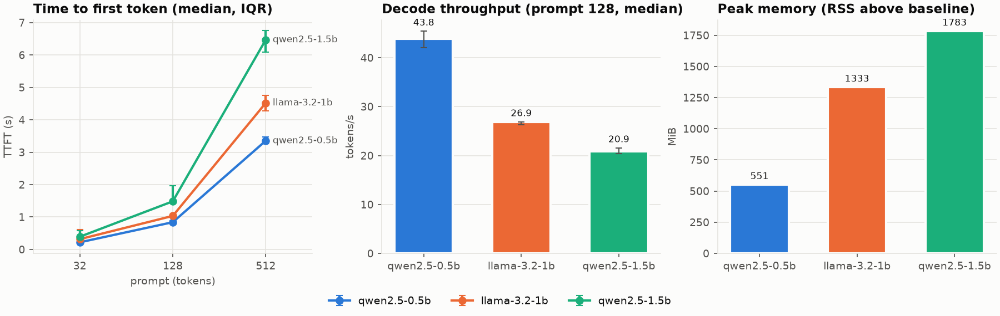
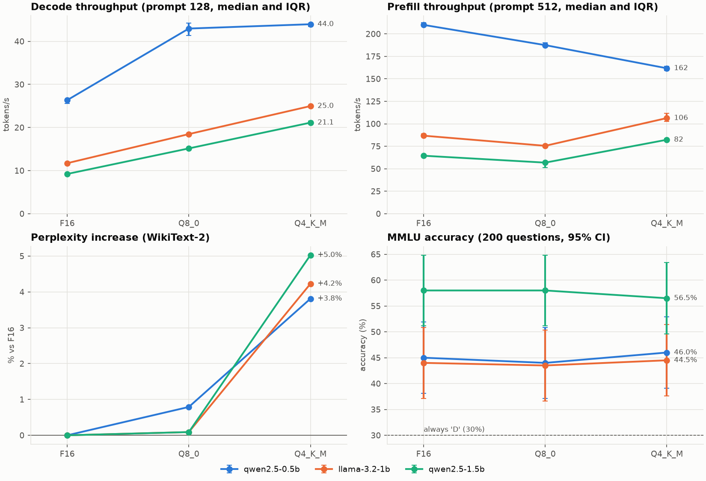
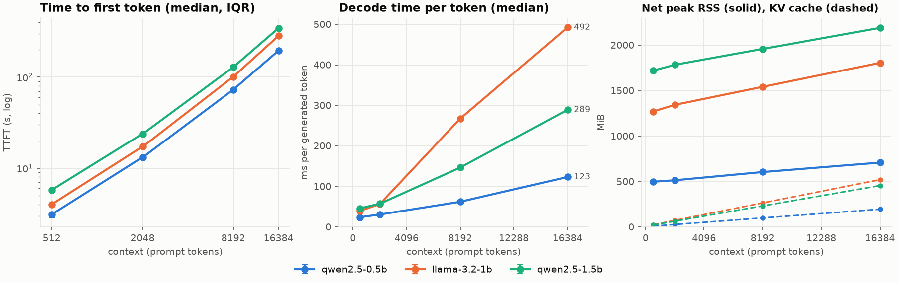
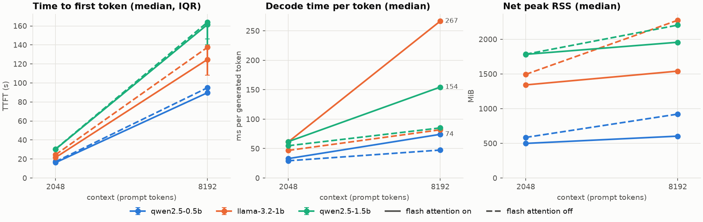
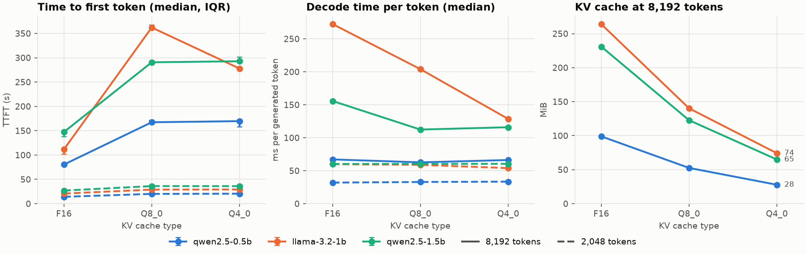
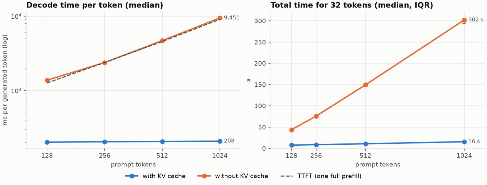
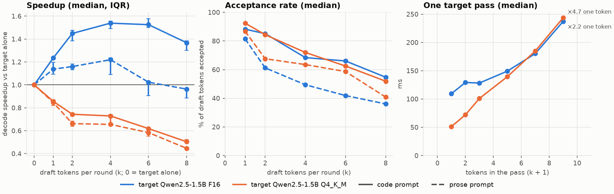

# llmbench — LLM inference benchmark

A reproducible benchmark of small open-source LLM inference: TTFT, latency, throughput,
memory, then the effect of quantization, the KV cache and speculative decoding.
Every experiment follows **hypothesis → protocol → measurements → conclusion**, and
negative results are kept.

## Reference hardware

| Component | Value | Consequence |
|---|---|---|
| CPU | AMD Ryzen 5 7520U (Zen 2, 4 cores / 8 threads, AVX2 + FMA + F16C, no AVX-512) | CPU inference: memory is the bottleneck, not compute |
| RAM (WSL2) | 7.4 GiB visible (host: 15.3 GB) | Models ≤ 1.5B; a 1.5B model in FP32 (~6 GB) does not fit |
| GPU | Radeon 610M iGPU, no CUDA | Not used: every experiment runs on the CPU |
| OS | Ubuntu 24.04 on WSL2 | The `env.json` snapshot is saved with every run |

## Repository layout

```
configs/            one YAML config per experiment (models, prompts, repetitions, quality)
src/llmbench/
  env.py            hardware/software snapshot + machine-state canary
  backends/         common interface: llama.cpp (GGUF), Hugging Face transformers (step 3d)
  metrics.py        TTFT, latency, throughput, aggregation (median, IQR, mean, CI)
  memory.py         peak memory (process RSS)
  quality.py        perplexity, agreement with a reference model, MMLU accuracy, McNemar test
  runner.py         interleaved experiment loop, JSONL output, run summaries
scripts/            run_experiment.py, run_quality.py, make_plots.py, download_models.py,
                    prepare_eval_data.py, check_env.py
data/prompts/       frozen prompt text for speed runs
data/eval/          frozen evaluation data (WikiText-2 extract, 200 MMLU questions)
results/<exp>/<run>/ raw.jsonl (not versioned) + env.json + config.yaml + summary.csv
figures/            plots generated from results/
notebooks/          reserved for GPU measurements on Kaggle (none yet)
tests/              unit tests (metrics, quality metrics, scheduling, memory sampling)
```

## Setup

```bash
uv venv && uv pip install -e ".[dev,llamacpp,hf]"
python scripts/check_env.py
pytest
```

## Measurement protocol

Lessons from the first runs are built into the runner:

- **AC power only.** On battery, throughput dropped ~1.8× and TTFT varied by ~40%.
- **Interleaved rounds.** Each repetition is a round that visits every model once, in a
  seeded shuffled order (load, two short warmup generations, one measurement per prompt
  length, unload). A first step 2 run that measured each model in one block was disturbed
  by activity on the host: one variant swung between 21 and 38 tok/s. Interleaving spreads
  such disturbances over different models instead of corrupting one.
- **Machine-state canary.** Under WSL2 the load average and steal time do not see the
  Windows host. Before every measurement the runner times a fixed memory-bound probe
  (summing 32 MiB); a slow canary flags a disturbed measurement.
- **Medians and interquartile ranges** in figures: the first round is sometimes slower
  (cold start), and the median is robust to it.
- **Fixed work.** Greedy decoding, fixed output length (EOS ignored), prompts cut to an exact
  number of tokens with each model's own tokenizer, prefix cache reset before every
  generation.

## Experiments

1. **Baseline**: TTFT, latency, throughput and memory of 3 small models — [results](#1-baseline)
2. **Weight quantization**: F16, Q8_0, Q4_K_M (speed, memory, perplexity, MMLU) — [results](#2-weight-quantization)
3. **KV cache**: effect of context length, flash attention, quantized KV cache, generation with vs without cache — [results](#3-kv-cache)
4. **Speculative decoding**: speedup, acceptance rate, cost of verification — [results](#4-speculative-decoding)

### 1. Baseline

**Hypothesis.** On CPU, decoding is bound by memory bandwidth: every token re-reads all the
weights, so decode throughput should be roughly inversely proportional to their size.
Prefill processes the prompt in batches, so TTFT should grow more slowly than prompt length.

**Protocol.** [`configs/01_baseline.yaml`](configs/01_baseline.yaml) — Qwen2.5-0.5B,
Llama-3.2-1B and Qwen2.5-1.5B (Instruct), all in Q4_K_M to isolate the effect of size;
llama.cpp, 4 threads, greedy decoding; prompts of 32, 128 and 512 tokens; 128 generated
tokens; 5 interleaved rounds.

```bash
python scripts/download_models.py configs/01_baseline.yaml
python scripts/run_experiment.py configs/01_baseline.yaml
python scripts/make_plots.py results/01_baseline/<run_id>
```



| Model (Q4_K_M) | Weights | TTFT 32 / 128 / 512 tok | Prefill @512 | Decode @128 (IQR) | Effective bandwidth | Net peak RSS |
|---|---|---|---|---|---|---|
| Qwen2.5-0.5B | 469 MiB | 0.22 / 0.84 / 3.35 s | 153 tok/s | 43.8 (42.0–45.4) tok/s | 21.5 GB/s | 551 MiB |
| Llama-3.2-1B | 770 MiB | 0.32 / 1.03 / 4.52 s | 113 tok/s | 26.9 (26.4–26.9) tok/s | 21.7 GB/s | 1,333 MiB |
| Qwen2.5-1.5B | 1,066 MiB | 0.39 / 1.48 / 6.47 s | 79 tok/s | 20.9 (20.5–21.6) tok/s | 23.3 GB/s | 1,783 MiB |

Medians over 5 rounds. Effective bandwidth = file size × decode throughput.
Run: [`results/01_baseline/20261022-002559/`](results/01_baseline/20261022-002559/).

**Conclusions.**
- *Decode is memory-bound: confirmed.* The three models reach the same effective bandwidth,
  21.5–23.3 GB/s, despite a 2.3× range of sizes: decode speed is set by how many bytes each
  token must read.
- *Sub-linear prefill: not supported.* From 128 to 512 tokens, prefill throughput is flat
  (0.5B: 152 → 153 tok/s; 1.5B: 86 → 79 tok/s), so TTFT grows about linearly with prompt
  length: a 128-token batch already keeps the CPU busy. At 32 tokens, measurements are
  bimodal (0.5B: either ~50 or ~150 tok/s, IQR 53–156) for a reason not identified yet, so
  no conclusion is drawn there.
- *Prefill and decode weigh about the same.* At 512 tokens, waiting for the first token
  takes 0.9–1.1× the time needed to generate the next 128.
- *Memory: weight size alone does not predict the footprint.* The overhead beyond the GGUF
  file ranges from ~80 MiB (0.5B) to ~560–720 MiB (1B, 1.5B). Breaking it down belongs to
  step 3 (KV cache).

**Correction.** A first step 1 run (2026-10-20, kept in
[`results/01_baseline/20261020-233651/`](results/01_baseline/20261020-233651/)) measured each
model in one block, without canary. It found slower 1B and 1.5B models (19.0 and
13.7 tok/s), hence an apparent "0.5B anomaly" in effective bandwidth, and prefill
throughput rising with prompt length (0.5B: 51 → 131 tok/s). Neither reproduces under the
interleaved protocol; both conclusions were withdrawn.

**Side observations (outside the protocol, worth keeping in mind).**
- *Power.* On battery (Windows "Balanced" plan), Qwen-0.5B dropped to 75 tok/s prefill and
  24 tok/s decode with ~40% TTFT variability, versus 138 and 41 tok/s (~3%) on AC power.
  All runs are therefore done on AC power.
- *Threads.* 8 threads (SMT) gave ~12 tok/s decode versus ~24 with 4 threads (measured on
  battery): the extra threads compete for the same memory bandwidth. All runs use 4
  threads, one per physical core.
- *Memory measurement.* Baseline RSS grows from one model to the next (78 → 187 MiB in the
  first run, memory not returned to the OS after unloading), so peak memory is reported
  net of the RSS measured just before each load.

### 2. Weight quantization

**Hypotheses.**
1. Decode is memory-bound, so its throughput should follow file size: ~1.9× for Q8_0 and
   ~3× for Q4_K_M relative to F16.
2. Prefill is compute-bound, so the gain should be much smaller; Q4_K_M may even be slower
   than Q8_0 because 4-bit weights must be unpacked before computing.
3. Q8_0 should be nearly indistinguishable from F16; Q4_K_M should lose a little, more so for
   the smallest model.

**Protocol.** [`configs/02_quantization.yaml`](configs/02_quantization.yaml) — the 3 models
of step 1 in F16, Q8_0 and Q4_K_M (9 variants). Speed: same protocol as step 1, prompts of
128 and 512 tokens, 5 interleaved rounds. Quality, each variant compared to the F16 of its
own family:
- *Perplexity* on a frozen WikiText-2 test extract (16 windows of 512 tokens, second half of
  each window scored: 4,096 tokens), as llama.cpp's `perplexity` tool does. Only comparable
  within one tokenizer, hence reported as a change vs F16.
- *Agreement with F16* on the same tokens: top-1 agreement, and a coarse KL divergence over
  the F16 top-20 tokens plus a "rest" bucket (a lower bound of the true KL; storing full
  150k-token distributions would cost ~1 GB per model).
- *MMLU*: 200 test questions drawn with a fixed seed, zero-shot; the answer is the most
  likely letter among A–D after "Answer:". Accuracy with its 95% CI, plus a paired
  comparison with F16 on the same questions (exact McNemar test).

```bash
python scripts/download_models.py configs/02_quantization.yaml
python scripts/run_experiment.py configs/02_quantization.yaml
python scripts/run_quality.py configs/02_quantization.yaml
python scripts/make_plots.py results/02_quantization/<run_id> --quality results/02_quantization/<quality_run_id>
```



**Speed** (medians over 5 rounds; decode at prompt 128, prefill and TTFT at prompt 512):

| Model | Format | File | Decode | vs F16 (size ratio) | Prefill | TTFT @512 | Net peak RSS |
|---|---|---|---|---|---|---|---|
| Qwen2.5-0.5B | F16 | 1,208 MiB | 26.4 tok/s | — | 210 tok/s | 2.44 s | 1,238 MiB |
| | Q8_0 | 644 MiB | 43.0 tok/s | 1.63× (1.88×) | 188 tok/s | 2.73 s | 674 MiB |
| | Q4_K_M | 469 MiB | 44.0 tok/s | 1.67× (2.58×) | 162 tok/s | 3.16 s | 520 MiB |
| Llama-3.2-1B | F16 | 2,365 MiB | 11.7 tok/s | — | 87 tok/s | 5.90 s | 2,485 MiB |
| | Q8_0 | 1,260 MiB | 18.5 tok/s | 1.58× (1.88×) | 76 tok/s | 6.78 s | 1,377 MiB |
| | Q4_K_M | 770 MiB | 25.0 tok/s | 2.13× (3.07×) | 106 tok/s | 4.81 s | 1,337 MiB |
| Qwen2.5-1.5B | F16 | 3,395 MiB | 9.2 tok/s | — | 64 tok/s | 7.94 s | 3,506 MiB |
| | Q8_0 | 1,807 MiB | 15.2 tok/s | 1.64× (1.88×) | 57 tok/s | 9.01 s | 1,918 MiB |
| | Q4_K_M | 1,066 MiB | 21.1 tok/s | 2.29× (3.18×) | 82 tok/s | 6.23 s | 1,774 MiB |

**Quality** (vs the F16 of the same model):

| Model | Format | Perplexity (± SE) | Δ vs F16 | Top-1 agreement | Coarse KL | MMLU (± 95% CI) | Answers changed | Fixed / broken | McNemar p |
|---|---|---|---|---|---|---|---|---|---|
| Qwen2.5-0.5B | F16 | 17.83 ± 0.83 | — | — | — | 45.0 ± 6.9% | — | — | — |
| | Q8_0 | 17.97 ± 0.84 | +0.8% | 97.2% | 0.0016 | 44.0 ± 6.9% | 3.5% | 1 / 3 | 0.63 |
| | Q4_K_M | 18.51 ± 0.86 | +3.8% | 90.8% | 0.0212 | 46.0 ± 6.9% | 14.0% | 10 / 8 | 0.81 |
| Llama-3.2-1B | F16 | 15.86 ± 0.72 | — | — | — | 44.0 ± 6.9% | — | — | — |
| | Q8_0 | 15.88 ± 0.72 | +0.1% | 98.4% | 0.0006 | 43.5 ± 6.9% | 2.5% | 0 / 1 | 1.00 |
| | Q4_K_M | 16.53 ± 0.75 | +4.2% | 90.3% | 0.0234 | 44.5 ± 6.9% | 20.0% | 14 / 13 | 1.00 |
| Qwen2.5-1.5B | F16 | 11.77 ± 0.50 | — | — | — | 58.0 ± 6.8% | — | — | — |
| | Q8_0 | 11.78 ± 0.50 | +0.1% | 98.0% | 0.0012 | 58.0 ± 6.8% | 1.0% | 1 / 1 | 1.00 |
| | Q4_K_M | 12.36 ± 0.53 | +5.0% | 89.1% | 0.0336 | 56.5 ± 6.9% | 6.0% | 3 / 6 | 0.51 |

The perplexity SE describes sampling noise of the text; the Δ vs F16 is far more precise,
since both variants are scored on exactly the same tokens.
Runs: [speed](results/02_quantization/20261022-003157/),
[quality](results/02_quantization/quality-20261021-222405/).

**Conclusions.**
- *Hypothesis 1, decode: direction confirmed, magnitude not.* Quantization speeds decode up
  less than file size predicts: Q8_0 gives 1.6× instead of 1.9×, Q4_K_M 1.7–2.3× instead of
  2.6–3.2×. Effective bandwidth drops from 29–33 GB/s in F16 to 20–24 GB/s in Q4_K_M:
  unpacking quantized weights costs compute, so quantized decode is no longer purely
  memory-bound on this 4-core CPU.
- *Hypothesis 2, prefill: half refuted.* The prefill gain is indeed small or negative, but
  not in the predicted order: Q8_0 is *slower* than F16 for all three models (−11 to −13%),
  and Q4_K_M is the fastest format for the 1B and 1.5B models (+22% and +28% vs F16) while
  the slowest for the 0.5B. A plausible but unverified cause is kernel support: llama.cpp
  repacks Q4_K weights into an AVX2-friendly layout at load time, which it does not do for
  Q8_0. This could be tested by disabling repacking. A likely reason why the 0.5B behaves
  differently: its "Q4_K_M" file is only 8% Q4_K. K-quants work on super-blocks of 256
  weights along a row, and its rows of 896 weights (3.5 × 256) cannot be split into them, so
  llama.cpp falls back to Q5_0 for 62% of the weights (Q8_0 for 22%, Q6_K for 8%). The
  Q4_K repack then barely applies (+28 MiB, against +446 MiB for the 1B), and Q5_0 is costly
  to unpack, which would also explain why its Q4_K_M decodes no faster than its Q8_0. The
  1B and 1.5B files are 67–76% Q4_K and 24–33% Q6_K. Not yet tested.
- *Hypothesis 3, quality: confirmed for Q8_0, partly refuted for Q4_K_M.* Q8_0 is close to
  F16 (perplexity +0.1%, except +0.8% for the 0.5B; ~98% top-1 agreement). Q4_K_M costs
  +3.8 to +5.0% perplexity and changes about 1 predicted token in 10, but the *largest*
  model loses the most perplexity, contrary to the prediction.
- *MMLU accuracy hides behavioural change.* No accuracy difference is detectable (all
  McNemar p ≥ 0.5, CIs of ±7 points). Yet Llama-3.2-1B in Q4_K_M changes 20% of its answers:
  14 fixed and 13 broken, which cancel out. Stable accuracy does not mean the same model.
- *Practical choice.* For Qwen2.5-0.5B, Q4_K_M decodes no faster than Q8_0 (44.0 vs
  43.0 tok/s) and prefills slower, for a 5× larger perplexity loss: Q8_0 dominates. For the
  1B and 1.5B models, Q4_K_M is the fastest format on both phases for a ~4–5% perplexity
  cost; Q8_0 is the choice when fidelity to F16 matters.
- *Memory.* Net peak RSS roughly halves from F16 to Q4_K_M, but Q8_0 → Q4_K_M saves little
  for the 1B and 1.5B models (−3% and −8%) despite files 39–41% smaller. RSS reflects which
  mapped pages are actually touched and the buffers llama.cpp allocates, not just the file;
  step 3 will break this down.

### 3. KV cache

During decode, each new token attends to every previous one. Their keys and values (K, V)
are kept in the **KV cache** instead of being recomputed, so its size grows linearly with the
context: 2 (K and V) × layers × KV heads × head size × 2 bytes (F16) per token. llama.cpp
allocates it for the whole `n_ctx` at load time, so each prompt length is measured with its
own load, with `n_ctx` = prompt + generated tokens. Flash attention is on in steps 3a and 3c,
because quantizing the V cache (step 3c) requires it; step 3b measures what it costs.

#### 3a. Context length

**Hypotheses.**
1. Each decoded token reads the weights *and* the KV cache, so the time per token should
   follow (weights + cache) / bandwidth. For Llama-3.2-1B at 16k tokens: 770 MiB of weights
   plus 520 MiB of cache, about 40% slower than a short context.
2. TTFT grows faster than linearly at long contexts: attention compares every prompt token
   with all the previous ones (quadratic cost), on top of the linear cost of the weights.
3. The KV cache does not explain the memory overhead seen in step 1: at 2k tokens it weighs
   27–72 MiB, against up to 720 MiB beyond the file size.

**Protocol.** [`configs/03_kv_context.yaml`](configs/03_kv_context.yaml) — the three models
of step 1 in Q4_K_M, F16 cache, flash attention on; prompts of 512, 2,048, 8,192 and 16,384
tokens cut from a frozen WikiText-2 extract; 128 generated tokens; 5 interleaved rounds
(60 measurements, 1 h 58, canary 2.5–3.6 ms).

```bash
python scripts/run_experiment.py configs/03_kv_context.yaml
python scripts/make_plots.py results/03_kv_context/<run_id>
```



| Model (Q4_K_M) | Context | TTFT | Prefill | Decode | ms / token | KV cache | Net peak RSS |
|---|---|---|---|---|---|---|---|
| Qwen2.5-0.5B | 512 | 3.1 s | 165 tok/s | 41.8 tok/s | 24 | 9 MiB | 497 MiB |
| | 2,048 | 13.2 s | 156 tok/s | 32.6 tok/s | 31 | 27 MiB | 513 MiB |
| | 8,192 | 72.9 s | 112 tok/s | 16.1 tok/s | 62 | 99 MiB | 604 MiB |
| | 16,384 | 196 s | 84 tok/s | 8.1 tok/s | 123 | 195 MiB | 708 MiB |
| Llama-3.2-1B | 512 | 4.0 s | 128 tok/s | 25.3 tok/s | 40 | 24 MiB | 1,269 MiB |
| | 2,048 | 17.2 s | 119 tok/s | 17.7 tok/s | 56 | 72 MiB | 1,342 MiB |
| | 8,192 | 101 s | 81 tok/s | 3.7 tok/s | 267 | 264 MiB | 1,540 MiB |
| | 16,384 | 284 s | 58 tok/s | 2.0 tok/s | 493 | 520 MiB | 1,804 MiB |
| Qwen2.5-1.5B | 512 | 5.8 s | 89 tok/s | 21.8 tok/s | 46 | 21 MiB | 1,718 MiB |
| | 2,048 | 23.8 s | 86 tok/s | 17.5 tok/s | 57 | 63 MiB | 1,783 MiB |
| | 8,192 | 129 s | 64 tok/s | 6.8 tok/s | 147 | 231 MiB | 1,957 MiB |
| | 16,384 | 346 s | 47 tok/s | 3.5 tok/s | 289 | 455 MiB | 2,189 MiB |

Medians over 5 rounds. ms / token = 1000 / decode throughput: unlike tokens/s, it adds up.
KV cache = size reserved by llama.cpp, which matches the formula above exactly.
Run: [`results/03_kv_context/20261025-064956/`](results/03_kv_context/20261025-064956/).

**Conclusions.**
- *Hypothesis 1, decode: refuted.* From 512 to 16k tokens, Llama-3.2-1B decodes 12× slower
  (25.3 → 2.0 tok/s), not 1.7× as the bytes read predict; both Qwen models slow down 5–6×.
  Beyond 2k tokens, the time per token grows about linearly with the context. Between 8k and
  16k, each extra context token costs 7.5 µs (Qwen 0.5B), 27.6 µs (Llama 1B) and 17.4 µs
  (Qwen 1.5B) per generated token, 13–19× more than reading its 12–32 KiB of cache at the
  ~22 GB/s of step 1 would take. At long contexts, decode is no longer bound by memory
  bandwidth but by the attention computation. Prime suspect, not yet verified: llama.cpp's
  CPU flash attention kernel. Step 3b measures it on vs off (confirmed there).
- *Hypothesis 2, TTFT: confirmed.* Prefill throughput roughly halves from 512 to 16k tokens
  for all three models. Llama-3.2-1B gets 32× more tokens but takes 71× longer (4.0 s →
  284 s). In practice, a 16k-token prompt means waiting about 5 minutes for the first token
  on this machine.
- *Hypothesis 3, memory: confirmed.* At 2k tokens the cache weighs 27–72 MiB, far from the
  step 1 overhead. It does explain the growth with context: from 512 to 16k, net peak RSS
  grows by 211 / 535 / 471 MiB and the cache by 186 / 496 / 434 MiB (Qwen 0.5B / Llama 1B /
  Qwen 1.5B). The load log points to two other contributors to the fixed overhead: a compute
  buffer of 259–303 MiB, reserved but not necessarily touched, and the Q4_K repack, which
  keeps a second copy of part of the weights (+28 MiB for the 0.5B, +446 MiB for the 1B,
  +597 MiB for the 1.5B). Not yet confirmed by disabling the repack.
- *Not comparable with steps 1–2.* Those runs had flash attention off. At 512 tokens the
  numbers are close (Llama decode 24.9 vs 25.3 tok/s), but a clean comparison needs an
  interleaved run: that is step 3b.

#### 3b. Flash attention on vs off

**Hypotheses.**
1. The CPU flash attention kernel is the decode bottleneck of step 3a: with it off, decode
   at 8k should be several times faster and get closer to the bandwidth prediction.
2. At 2k, where the cache is small, both settings should decode at about the same speed.
3. Without flash attention, llama.cpp materializes the attention scores, so its compute
   buffer should grow with the context.

**Protocol.** [`configs/03_flash_attn.yaml`](configs/03_flash_attn.yaml) — same three Q4_K_M
models, F16 cache, flash attention on vs off, prompts of 2,048 and 8,192 tokens, 128
generated tokens; 3 interleaved rounds, the spread of step 3a (2–5% of the mean) being far
below the effect sought (36 measurements, 51 min, canary 2.5–3.5 ms).

```bash
python scripts/run_experiment.py configs/03_flash_attn.yaml
python scripts/make_plots.py results/03_flash_attn/<run_id>
```



| Model (Q4_K_M) | Context | Flash attn | TTFT | Decode | ms / token | Compute buffer | Net peak RSS |
|---|---|---|---|---|---|---|---|
| Qwen2.5-0.5B | 2,048 | on | 16.2 s | 30.3 tok/s | 33 | 300 MiB | 499 MiB |
| | | off | 17.2 s | 34.1 tok/s | 29 | 300 MiB | 586 MiB |
| | 8,192 | on | 89.8 s | 13.5 tok/s | 74 | 300 MiB | 604 MiB |
| | | off | 95.0 s | 21.1 tok/s | 47 | 302 MiB | 922 MiB |
| Llama-3.2-1B | 2,048 | on | 21.6 s | 16.3 tok/s | 61 | 259 MiB | 1,342 MiB |
| | | off | 24.5 s | 21.3 tok/s | 47 | 259 MiB | 1,494 MiB |
| | 8,192 | on | 124.8 s | 3.8 tok/s | 263 | 259 MiB | 1,541 MiB |
| | | off | 137.5 s | 12.2 tok/s | 82 | 567 MiB | 2,274 MiB |
| Qwen2.5-1.5B | 2,048 | on | 30.3 s | 16.2 tok/s | 62 | 303 MiB | 1,783 MiB |
| | | off | 30.5 s | 18.2 tok/s | 55 | 303 MiB | 1,785 MiB |
| | 8,192 | on | 161.5 s | 6.5 tok/s | 154 | 303 MiB | 1,957 MiB |
| | | off | 164.0 s | 11.7 tok/s | 85 | 306 MiB | 2,205 MiB |

Medians over 3 rounds. Compute buffer = size reserved by llama.cpp at load time.
Run: [`results/03_flash_attn/20261101-083445/`](results/03_flash_attn/20261101-083445/).

**Conclusions.**
- *Hypothesis 1, decode bottleneck: confirmed.* At 8k, turning flash attention off makes
  decode 3.2× faster on Llama-3.2-1B (3.8 → 12.2 tok/s), 1.6× on Qwen 0.5B and 1.8× on
  Qwen 1.5B. The cost of each extra context token drops from 33 to 5.7 µs per generated
  token on Llama (6.7 → 2.9 µs on Qwen 0.5B, 15.0 → 5.0 µs on Qwen 1.5B), between 2,048 and
  8,192 tokens. That is much closer to the bandwidth prediction (0.6–1.5 µs to read one
  token of cache at ~22 GB/s), but still 4–5× above it: without flash attention, decode at
  long contexts is still not purely bandwidth-bound.
- *Hypothesis 2, same speed at 2k: refuted.* Flash attention off is already 12–31% faster at
  2k. The CPU kernel costs something at every context length; the gap grows with it.
- *Prefill.* Flash attention on is the faster setting here, but only by 1–12% on TTFT. On
  this CPU it helps prefill a little and hurts decode a lot: at 8k, Llama with flash
  attention off generates 128 tokens in 148 s end to end, against 158 s with it on.
- *Hypothesis 3, compute buffer: confirmed for Llama only.* Without flash attention, its
  reserved compute buffer grows from 259 to 567 MiB at 8k; Qwen's barely moves. Consistent
  with the size of the attention score matrix for a 512-token batch (context × 512 × heads
  × 4 bytes): 520 MiB for Llama's 32 heads at 8k, but only 195–228 MiB for Qwen's 12–14
  heads, less than the 297 MiB of their logits buffer (151,936-token vocabulary × 512 × 4
  bytes), which already sets the buffer size. Net peak RSS still grows more than the
  reserved buffers at 8k (+318 / +733 / +248 MiB for Qwen 0.5B / Llama 1B / Qwen 1.5B);
  that extra memory is not identified yet.
- *Steps 1–2 vs 3a.* Steps 1–2 ran with flash attention off, step 3a with it on: their
  numbers are comparable at short contexts only. At 512 tokens the two were close (Llama
  decode 24.9 vs 25.3 tok/s); at 2k, flash attention off is already faster.
- *Run-to-run variation.* The first round of a run prefills faster than the next ones
  (Llama 8k TTFT 91.5 s, then 125.0 and 124.8 s), in both settings, which stay ordered the
  same way within each round. Decode varies less, by 12% at most. Compare TTFT within a run, not across
  runs: the same F16, flash-attention-on cell gave 101 s in 3a, 125 s in 3b and 112 s in 3c.

#### 3c. Quantized KV cache

**Hypotheses.**
1. Quantizing the cache shrinks its memory in proportion to its bits: Q8_0 to 34/64 of F16,
   Q4_0 to 18/64 (block of 32 values + a 2-byte scale).
2. It speeds decode up at long contexts, where the cache is a large share of the bytes read
   per token; at 2k the cache is small, so little should change.
3. Q8_0 should be nearly lossless, Q4_0 a little less — not measured in this run, which is
   speed and memory only.

**Protocol.** [`configs/03_kv_quant.yaml`](configs/03_kv_quant.yaml) — same three Q4_K_M
models, flash attention on (llama.cpp requires it to quantize V), F16 vs Q8_0 vs Q4_0 for
both K and V, prompts of 2,048 and 8,192 tokens, 128 generated tokens; 3 interleaved rounds
(54 measurements, 1 h 55, canary 2.6–3.4 ms). 8k rather than 16k: 16k prefills alone would
have taken about 4 hours, and at 8k the cache is already a third of Llama's weights.

```bash
python scripts/run_experiment.py configs/03_kv_quant.yaml
python scripts/make_plots.py results/03_kv_quant/<run_id>
```



| Model (Q4_K_M) | Context | KV cache | TTFT | Decode | ms / token | KV cache size | Net peak RSS |
|---|---|---|---|---|---|---|---|
| Qwen2.5-0.5B | 2,048 | F16 | 14.2 s | 31.3 tok/s | 32 | 27 MiB | 520 MiB |
| | | Q8_0 | 20.1 s | 30.4 tok/s | 33 | 14 MiB | 497 MiB |
| | | Q4_0 | 20.6 s | 29.9 tok/s | 33 | 8 MiB | 497 MiB |
| | 8,192 | F16 | 80.5 s | 14.9 tok/s | 67 | 99 MiB | 610 MiB |
| | | Q8_0 | 167 s | 15.9 tok/s | 63 | 53 MiB | 577 MiB |
| | | Q4_0 | 170 s | 15.1 tok/s | 66 | 28 MiB | 534 MiB |
| Llama-3.2-1B | 2,048 | F16 | 20.8 s | 16.7 tok/s | 60 | 72 MiB | 1,342 MiB |
| | | Q8_0 | 28.9 s | 17.0 tok/s | 59 | 38 MiB | 1,305 MiB |
| | | Q4_0 | 29.3 s | 18.5 tok/s | 54 | 20 MiB | 1,266 MiB |
| | 8,192 | F16 | 112 s | 3.7 tok/s | 270 | 264 MiB | 1,540 MiB |
| | | Q8_0 | 362 s | 4.9 tok/s | 204 | 140 MiB | 1,419 MiB |
| | | Q4_0 | 278 s | 7.8 tok/s | 128 | 74 MiB | 1,347 MiB |
| Qwen2.5-1.5B | 2,048 | F16 | 27.0 s | 16.6 tok/s | 60 | 63 MiB | 1,783 MiB |
| | | Q8_0 | 36.2 s | 16.6 tok/s | 60 | 34 MiB | 1,717 MiB |
| | | Q4_0 | 36.1 s | 16.5 tok/s | 61 | 18 MiB | 1,717 MiB |
| | 8,192 | F16 | 147 s | 6.4 tok/s | 156 | 231 MiB | 1,957 MiB |
| | | Q8_0 | 291 s | 8.9 tok/s | 112 | 123 MiB | 1,846 MiB |
| | | Q4_0 | 293 s | 8.6 tok/s | 116 | 65 MiB | 1,788 MiB |

Medians over 3 rounds. Run:
[`results/03_kv_quant/20261101-092609/`](results/03_kv_quant/20261101-092609/).

**Conclusions.**
- *Hypothesis 1, memory: confirmed.* The reserved cache is exactly 34/64 (Q8_0) and 18/64
  (Q4_0) of F16, and net peak RSS falls by about as much as the cache (Llama 8k: −121 and
  −193 MiB of RSS for −124 and −190 MiB of cache).
- *Hypothesis 2, decode: confirmed at 8k for the 1B and 1.5B models, not for the 0.5B.* At
  8k, Q4_0 doubles Llama's decode (3.7 → 7.8 tok/s) and Q8_0 speeds it up by a third; Qwen
  1.5B gains 34–39% with either. Qwen 0.5B, whose cache is the smallest (99 MiB), barely
  changes (+1 to +7%). At 2k, decode moves by 11% at most, as expected. Step 3a showed that decode at
  long contexts is bound by the attention computation rather than by bandwidth, so the gain
  likely comes from a faster kernel path for quantized K/V in llama.cpp rather than from
  fewer bytes read; not verified. Even so, Llama with an F16 cache and flash attention off
  (12.2 tok/s in step 3b) still decodes faster than with any quantized cache.
- *Not predicted: prefill becomes 2–3× slower.* At 8k, TTFT goes from 112 to 362 s (Q8_0)
  and 278 s (Q4_0) on Llama, and roughly doubles on both Qwen models; at 2k it already rises
  by 34–45%. Mechanism not identified. Q8_0 prefills slower than Q4_0 on Llama.
- *In practice.* For a long prompt and a short answer, a quantized cache loses on this CPU:
  Llama at 8k needs 294 s end to end for 128 tokens with Q4_0, against 146 s with F16. Its
  faster decode only pays off beyond about 1,200 generated tokens. Its real benefit is
  memory: it fits a longer context in the same RAM.
- *Quality not measured.* Whether Q8_0 is lossless and how much Q4_0 degrades the output
  remains open (perplexity with a quantized cache).

#### 3d. With vs without the KV cache

llama.cpp cannot turn its cache off, Hugging Face `transformers` can. The HF backend
([`src/llmbench/backends/hf.py`](src/llmbench/backends/hf.py)) runs a hand-written greedy
loop: one forward pass per token, either the new token against the cache, or the whole
sequence without it. Only the last position goes through the vocabulary projection, so
turning the cache off only adds the recomputation of the transformer.

**Hypotheses.** Without the cache, generating N tokens after a P-token prompt processes
about N·P + N²/2 tokens instead of P + N.
1. With the cache, decode time per token barely depends on P. Without it, each token costs
   about one prefill of the whole sequence: time per token grows linearly with P, and the
   gap reaches tens of times at P = 1,024.
2. TTFT is the same either way: the first token comes from the prefill.
3. The generated text is identical: the cache is an exact optimization.
4. The cache itself is small here: 24 KiB per token in float32, about 25 MiB at 1,056
   tokens.

**Protocol.** [`configs/03_kv_hf.yaml`](configs/03_kv_hf.yaml) — Qwen2.5-0.5B-Instruct in
float32 (this CPU has no AVX-512 BF16), 4 threads; prompts of 128, 256, 512 and 1,024
tokens from the same WikiText-2 extract; 32 generated tokens (without the cache, one token
at 1,024 takes ~9 s); 3 interleaved rounds (24 measurements, 30 min, canary 2.7–4.4 ms).

```bash
python scripts/download_models.py configs/03_kv_hf.yaml
python scripts/run_experiment.py configs/03_kv_hf.yaml
python scripts/make_plots.py results/03_kv_hf/<run_id>
```



| Prompt | Cache | TTFT | Decode | ms / token | Total, 32 tokens | Slowdown (decode / total) |
|---|---|---|---|---|---|---|
| 128 | on | 1.26 s | 4.97 tok/s | 201 | 7.5 s | |
| | off | 1.32 s | 0.73 tok/s | 1,372 | 43.8 s | 6.8× / 5.8× |
| 256 | on | 2.37 s | 4.91 tok/s | 204 | 8.7 s | |
| | off | 2.26 s | 0.42 tok/s | 2,375 | 75.8 s | 11.7× / 8.7× |
| 512 | on | 4.55 s | 4.87 tok/s | 205 | 10.8 s | |
| | off | 4.42 s | 0.21 tok/s | 4,673 | 149.4 s | 22.7× / 13.8× |
| 1,024 | on | 9.05 s | 4.81 tok/s | 208 | 15.6 s | |
| | off | 9.03 s | 0.11 tok/s | 9,434 | 302.0 s | 45× / 19× |

Medians over 3 rounds.
Run: [`results/03_kv_hf/20261101-141821/`](results/03_kv_hf/20261101-141821/).

**Conclusions.**
- *Hypothesis 1, decode: confirmed.* With the cache, time per token stays at 201–208 ms from
  128 to 1,024 tokens. Without it, it doubles every time the prompt doubles, and each step
  costs 4–6% more than the TTFT of the same prompt: every new token is a full prefill of a
  slightly longer sequence. At 1,024 tokens, decode is 45× slower and the 32 tokens take
  5 minutes instead of 16 s.
- *Hypothesis 2, TTFT: confirmed.* Within 5% at every length, in both directions.
- *Hypothesis 3, same output: confirmed.* The generated text is identical with and without
  the cache, for every prompt and every round (also checked on a tiny random model in
  [`tests/test_hf_backend.py`](tests/test_hf_backend.py)).
- *Hypothesis 4, memory: not measurable in this run.* Both settings run in the same process,
  one after the other, and memory freed by the first load is not returned to the OS: net
  peak RSS ranges from 833 to 2,296 MiB depending on which setting was loaded first in the
  round, far more than the ~25 MiB the cache should weigh.
- *Hugging Face vs llama.cpp.* With the cache, transformers decodes at 4.9 tok/s, which
  means reading the 1.98 GB of float32 weights at about 9.7 GB/s, against about 33 GB/s
  for llama.cpp with the same model in F16 (step 2). Its prefill (~113 tok/s at 512 tokens) is also about half of
  llama.cpp's F16 prefill (210 tok/s). Different precisions and flash attention settings:
  an order of magnitude, not a controlled comparison.
- *Why the cache matters.* Without it, every generated token turns decode back into a
  prefill. With it, decode reads the weights once per token plus a cache that grows
  linearly, which is the regime measured in steps 1 to 3c.

### 4. Speculative decoding

Decode reads all the weights for every token. In speculative decoding, a small **draft**
model guesses k tokens one by one, and the **target** model checks them all in a single
forward pass: it keeps the longest prefix it agrees with, plus one token of its own. If
the guesses are often right, the target produces several tokens per pass. With greedy
decoding, the output is in principle exactly the target's own.

The loop is hand-written ([`src/llmbench/speculative.py`](src/llmbench/speculative.py)) on top
of llama.cpp contexts: batches are built by hand so only the needed positions get logits,
and rejected guesses are dropped from the KV cache by rolling it back. Tested on fake
models: same output as the target alone for any k and any draft quality
([`tests/test_speculative.py`](tests/test_speculative.py)).

**Hypotheses.** With an acceptance rate α, a round costs k draft steps plus one target
pass, and yields 1 + (accepted guesses) tokens. The gain depends on the draft-to-target
cost ratio c, from the step 2 decode speeds: 0.21 for an F16 target (9.2 tok/s, against
43 tok/s for the Q8_0 draft), 0.49 for a Q4_K_M target (21 tok/s).
1. With α = 0.7 and k = 4, the F16 target should speed up ~1.4×; the Q4_K_M target should
   not gain, or slow down (~0.9×).
2. A target pass over k + 1 tokens costs about one decode step for small k (the weights are
   read once), then more as the CPU becomes compute-bound.
3. Code is more predictable than prose: higher acceptance rate.
4. There is a best k: too small gains little, too large wastes rejected guesses.
5. The output is exactly the target's greedy output, for every k.

**Protocol.** [`configs/04_speculative.yaml`](configs/04_speculative.yaml) — draft
Qwen2.5-0.5B Q8_0, targets Qwen2.5-1.5B F16 and Q4_K_M (same tokenizer, required to compare
guesses); k ∈ {1, 2, 4, 6, 8} and the target alone (k = 0); prose (WikiText-2) and code (a
frozen copy of `runner.py`) prompts of 256 tokens; 128 generated tokens; flash attention
off. 5 interleaved rounds: each loads both targets in a shuffled order, then runs every
(prompt, k) pair in a shuffled order. Speedup = decode throughput over that of the target
alone, in the same round and on the same prompt. 120 generations, 48 min, canary
2.6–3.6 ms. The draft's prefill counts in the TTFT, not in decode.

```bash
python scripts/run_speculative.py configs/04_speculative.yaml
python scripts/make_plots.py results/04_speculative/<run_id>
```



| Target (Qwen2.5-1.5B) | Prompt | k = 1 | k = 2 | k = 4 | k = 6 | k = 8 |
|---|---|---|---|---|---|---|
| F16 (alone: 9.4 tok/s) | code | 1.24× (88%) | 1.45× (85%) | **1.54× (68%)** | 1.53× (66%) | 1.37× (55%) |
| | prose | 1.14× (81%) | 1.16× (61%) | **1.22× (49%)** | 1.02× (42%) | 0.96× (36%) |
| Q4_K_M (alone: 21.0 tok/s) | code | 0.86× (92%) | 0.74× (84%) | 0.73× (72%) | 0.62× (62%) | 0.50× (52%) |
| | prose | 0.85× (87%) | 0.66× (68%) | 0.66× (64%) | 0.58× (59%) | 0.45× (41%) |

Decode speedup against the target alone (median over 5 rounds), and in brackets the share
of draft tokens accepted.

| Tokens in one target pass | 1 | 2 | 3 | 5 | 7 | 9 |
|---|---|---|---|---|---|---|
| F16 | 109 ms | 129 ms (1.18×) | 128 ms (1.17×) | 149 ms (1.36×) | 180 ms (1.65×) | 237 ms (2.17×) |
| Q4_K_M | 51 ms | 72 ms (1.40×) | 101 ms (1.97×) | 139 ms (2.72×) | 185 ms (3.60×) | 244 ms (4.75×) |

Run: [`results/04_speculative/20261102-004802/`](results/04_speculative/20261102-004802/).

**Conclusions.**
- *Hypothesis 1: confirmed.* The F16 target gains up to 1.54× (9.4 → 14.4 tok/s on code,
  k = 4); the Q4_K_M target is slower at every k, down to 0.45×. The cost model holds once
  fed with measured times: at k = 4 a round costs 4 draft steps of ~25 ms plus one target
  pass (160 ms in F16, 148 ms in Q4_K_M) for 3.7–3.9 tokens, i.e. 69 ms per token against
  107 ms for the F16 target alone (1.55×), and 64 ms against 48 ms for Q4_K_M (0.74×).
- *Hypothesis 2: confirmed for F16, refuted for Q4_K_M.* Five tokens cost 1.36× one token in
  F16 but 2.72× in Q4_K_M. Both take about the same absolute time (~140–150 ms): once
  several tokens share a pass, the work is compute, not reading weights. A Q4_K_M decode
  step is fast because it reads few bytes, so there is little left to share. Same mechanism
  as step 2: dequantizing the weights costs compute.
- *Hypothesis 3: confirmed.* At k = 4, 68–72% of the guesses are accepted on code, 49–64%
  on prose. The F16 target gains 1.54× on code but only 1.22× on prose.
- *Hypothesis 4: confirmed.* The best k is 4 for the F16 target (k = 6 is as good on code).
  Beyond, the acceptance rate keeps falling while the target pass gets more expensive: at
  k = 8, prose is slower than the target alone.
- *Hypothesis 5: confirmed for F16, refuted for Q4_K_M.* With the F16 target, the output is
  identical to the target alone in all 50 generations. With the Q4_K_M target it differs in
  all 50, at the same place in every round for a given prompt and k (token 79 on code,
  token 4, 30 or 47 on prose depending on k). The algorithm is exact in exact arithmetic, but llama.cpp does not
  round a batch of tokens the same way as one token at a time: the logits differ by up to
  0.6 in Q4_K_M (0.009 in F16), enough to flip a near-tie. The output is still a plausible
  greedy output of the same model, not the bit-identical one.
- *In practice.* Speculative decoding pays off when the draft is much cheaper than the
  target *and* verifying several tokens costs little more than one. On a GPU, decode leaves
  most of the compute idle, so both usually hold. On this CPU, they only hold for an
  unquantized target: with a 4-bit target, the plain target is faster.

## Key takeaways

1. **On CPU, decode speed is set by the bytes read per token.** Three models of different
   sizes all decode at the same effective bandwidth, 21–23 GB/s (step 1). A model's file
   size predicts its decode speed better than its parameter count.
2. **Quantization reads fewer bytes, but unpacking them costs compute.** Q4_K_M decodes
   1.7–2.3× faster than F16 instead of the 2.6–3.2× its size promises, for +4–5% perplexity;
   Q8_0 is nearly lossless (step 2). Unchanged MMLU accuracy hid 6–20% of changed answers:
   agreement with the reference says more than accuracy alone.
3. **Long contexts move the bottleneck from memory to compute.** At 16k tokens, Llama-3.2-1B
   decodes 12× slower than at 512, where reading the larger cache predicts 1.7×, and waits
   ~5 minutes for its first token (step 3a). Most of that decode cost is llama.cpp's CPU
   flash attention kernel: turned off, 8k decode is 3.2× faster (step 3b).
4. **The KV cache is exact and indispensable; its price is memory.** Without it, every token
   is a full prefill: 45× slower at 1,024 tokens, same output (step 3d). Its size follows a
   simple formula, exact to the MiB, that grouped-query attention keeps small. Quantizing it
   divides that memory by ~2 (Q8_0) or ~3.6 (Q4_0) and speeds long decode up, but makes
   prefill 2–3× slower: a memory tool, not a speed tool for long prompts with short answers
   (step 3c).
5. **Speculative decoding needs both a cheap draft and a cheap verification.** A 0.5B draft
   speeds a F16 1.5B target up to 1.54×, but slows the same target in Q4_K_M at every k
   (step 4). The common thread with points 2 and 3: as soon as the work stops being
   bandwidth-bound (unpacking weights, verifying a batch of tokens, attending over a long
   context), the gains expected from "fewer bytes" shrink or reverse on a 4-core CPU.
6. **"Exact" depends on the arithmetic.** Speculative decoding is exact in principle, yet
   with a Q4_K_M target its output never matched the target alone: llama.cpp does not round
   a batch of tokens like a single token (logits up to 0.6 apart), enough to flip near-ties.
7. **Measurement protocol matters as much as the code.** Interleaved rounds and a canary
   withdrew two wrong conclusions from the first run; battery power cost ~1.8× throughput;
   TTFT drifts between rounds, so it is only compared within a run.
